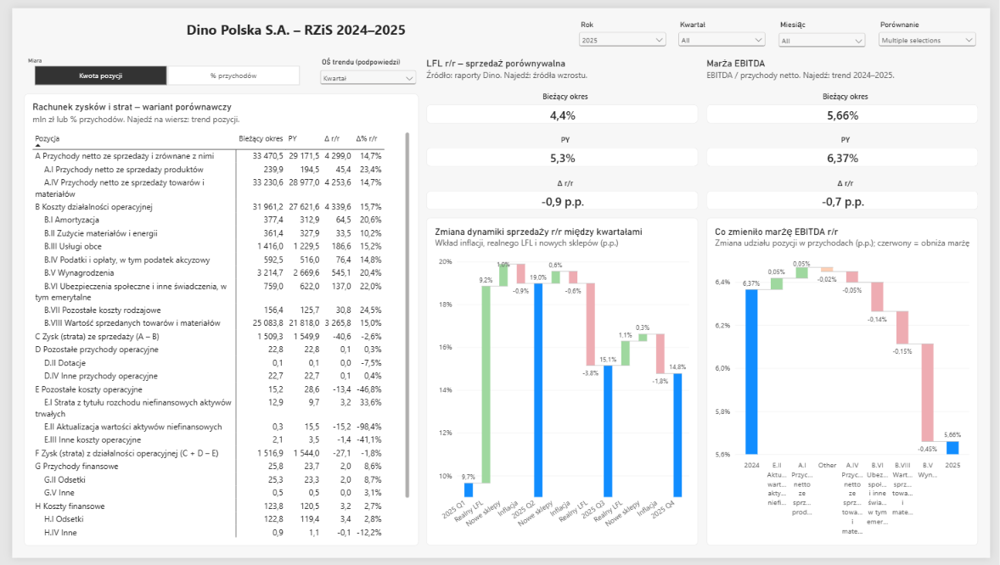
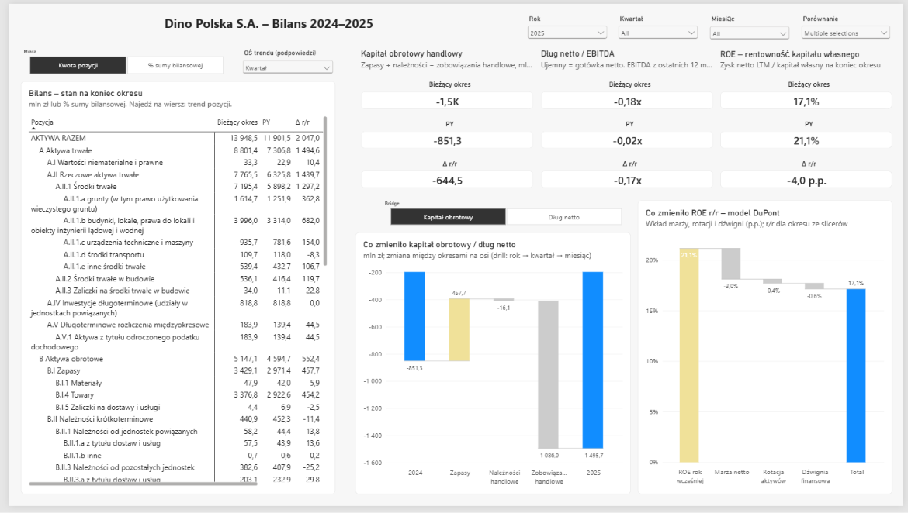
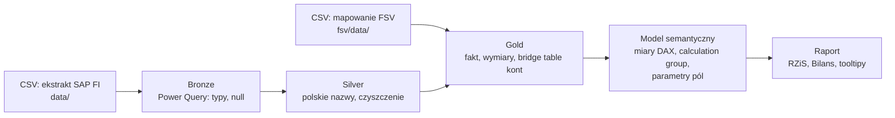

# Dino Polska – sprawozdanie finansowe w Power BI (SAP FI → Power Query → Power BI)

Raport finansowy zbudowany od surowych zapisów księgowych SAP ECC FI do rachunku zysków i strat (wariant porównawczy) i bilansu zgodnych z ustawą o rachunkowości, z analizą KPI i bridge'ami wyjaśniającymi zmiany r/r.

> **EN summary:** End-to-end financial reporting project in Power BI. A synthetic SAP ECC FI extract (BKPF/BSEG, G/L master data), calibrated to the published standalone statements of Dino Polska S.A. for 2024–2025, is modelled in Power Query (bronze/silver/gold) and mapped to the Polish statutory P&L and balance sheet through an account-to-line bridge table. The report explains revenue growth (LFL vs. new stores vs. food inflation), EBITDA margin, working capital, net debt and ROE (DuPont) with waterfall bridges.




## Najważniejsze wnioski (2025 vs 2024)

| Obszar | 2024 | 2025 | Co z tego wynika |
|---|---|---|---|
| Przychody netto | 29 171,5 mln zł | 33 470,5 mln zł | +14,7% r/r, z czego ok. 10,3 p.p. to nowe sklepy, a 4,4 p.p. sprzedaż porównywalna (LFL) |
| LFL vs inflacja żywności (GUS) | 5,3% vs 3,3% | 4,4% vs 4,7% | realny LFL spadł z +2,0 do −0,3 p.p. – cały wzrost LFL w 2025 to efekt cen |
| Marża EBITDA | 6,37% | 5,66% | spadek głównie przez koszty pracy (wynagrodzenia −0,45 p.p., ZUS −0,14 p.p.) |
| Kapitał obrotowy handlowy | −851,2 mln zł | −1 495,7 mln zł | dostawcy finansują zapasy; cykl konwersji gotówki z −15,4 do −22,7 dnia |
| Dług netto / EBITDA (LTM) | −0,02x | −0,18x | gotówka netto mimo dużych inwestycji; spłata 203 mln zł obligacji |
| ROE (DuPont) | 21,1% | 17,1% | −3,0 p.p. marża netto, −0,4 p.p. rotacja aktywów, −0,6 p.p. dźwignia (zysk zostaje w spółce) |

## Dane

**Źródło:** syntetyczny ekstrakt SAP ECC FI (folder `data/`, CSV) skalibrowany do **opublikowanych jednostkowych sprawozdań Dino Polska S.A.** – każda pozycja RZiS w każdym kwartale 2024–2025 i każda pozycja bilansu na koniec roku oraz sumy cząstkowe na koniec każdego kwartału zgadzają się co do tysiąca złotych (378 porównań, różnica 0). Wszystko poniżej tego poziomu (regiony, MPK, dostawcy, pojedyncze transakcje, podział kwartału na miesiące) jest wygenerowane.

| Tabela SAP | Znaczenie | Wiersze |
|---|---|---|
| `bkpf` / `bseg` | nagłówki / pozycje dokumentów księgowych | 20 017 / 59 618 |
| `ska1`, `skat`, `skb1` | plan kont | 69 |
| `faglflext` | salda kont (ledger 0L) | 401 |
| `csks`, `cepc`, `lfa1`, `lfb1`, `kna1`, `t003t` | MPK, centra zysku, dostawcy, odbiorcy, rodzaje dokumentów | – |

**Mapowanie sprawozdania** (`fsv/data/`): 101 pozycji RZiS i bilansu (`fs_line.csv`) i 78 zakresów kont (`fs_account.csv`), z osobnymi pozycjami dla salda Wn i Ma (VAT, rozrachunki, bank).

**Dane zewnętrzne** (wpisane w model jako tabele referencyjne): LFL z raportów okresowych Dino i inflacja „żywność i napoje bezalkoholowe” r/r z GUS.

## Architektura



- **Bronze** – CSV wczytane 1:1 z typami jak w SAP (kultura `en-US`, puste pola → null, zera wiodące w numerach kont i dokumentów zachowane).
- **Silver** – polskie nazwy kolumn, strona Wn/Ma, numer konta 6-cyfrowy.
- **Gold** – `gold_fct_ksiegowania` (BSEG ⋈ BKPF, kwota: Wn +, Ma −), `gold_dim_konto`, `gold_dim_pozycja` (pozycje sprawozdania z kolejnością i znakiem prezentacji), `gold_dim_kalendarz`, `gold_bridge`.

### Bridge table kont (`gold_bridge`)

Łączy konto księgowe z pozycją sprawozdania (relacja wiele-do-wielu przez tabelę mostkową):
- **zakresy kont** z `fs_account` → pozycje RZiS i bilansu,
- **strona salda** – konto trafia do aktywów albo pasywów zależnie od salda (np. VAT, rozrachunki, rachunek bankowy),
- **pozycje formułowe** RZiS (C, F, I, L) jako zestaw kont ze znakami,
- **wynik finansowy** w pasywach (zysk z lat ubiegłych / roku bieżącego) liczony z kont wynikowych.

Jedna miara `Kwota pozycji` liczy RZiS z obrotów okresu, a bilans z sald na koniec okresu.

## Model i DAX

| Element | Opis |
|---|---|
| `Kwota pozycji` | RZiS = obroty kont pozycji w okresie, bilans = saldo na koniec okresu po właściwej stronie; mln zł ze znakiem prezentacji |
| Calculation group `Comparison` | Bieżący okres, PY, Δ r/r (dla wskaźników w p.p.), Δ% r/r, YTD, YTD PY, Koniec poprzedniego roku, Δ od końca roku (bilans śródroczny jak w raportach kwartalnych) |
| Parametry pól | przełącznik kwota / % przychodów (RZiS), kwota / % sumy bilansowej (bilans), wybór bridge'a, oś trendu w tooltipach |
| LTM | EBITDA, zysk netto i przychody z ostatnich 12 miesięcy dla wskaźników łączących przepływ ze stanem (dług netto/EBITDA, ROE, rotacja aktywów) |
| DuPont | ROE = marża netto × rotacja aktywów × dźwignia; wkład czynników metodą dekompozycji logarytmicznej (słupki sumują się dokładnie do zmiany ROE) |
| Bridge LFL | dynamika przychodów = inflacja żywności + realny LFL + nowe sklepy |
| Bridge marży EBITDA | zmiana udziału każdej pozycji kosztowej w przychodach (p.p.) |
| Bridge KOH / długu | zmiana składników kapitału obrotowego i długu netto między okresami |

## Strony raportu

**RZiS** – macierz RZiS z porównaniami, karty LFL i marży EBITDA, bridge dynamiki sprzedaży (kwartały 2025) i bridge marży EBITDA 2024 → 2025. Tooltipy: trend pozycji, trend marży, skład dynamiki (inflacja / realny LFL / nowe sklepy).

**Bilans** – macierz bilansu (kwota / % sumy bilansowej), karty kapitału obrotowego, dług netto / EBITDA i ROE, bridge KOH / długu netto oraz bridge ROE (DuPont). Tooltipy: trendy KPI i cykl konwersji gotówki (rotacja zapasów, należności, zobowiązań w dniach).

## Uruchomienie

1. Sklonuj repozytorium.
2. Otwórz `dino_financial_report.pbip` w Power BI Desktop (format projektu PBIP / TMDL).
3. **Przekształć dane → Edytuj parametry →** ustaw `FolderDanych` na folder repozytorium (z ukośnikiem na końcu), np. `C:\repo\dino\`.
4. **Odśwież.** Kontrola: przychody 2025 = 33 470,5 mln zł, suma bilansowa 31.12.2025 = 13 948,5 mln zł.

## Struktura repozytorium

```
data/                                ekstrakt SAP FI (CSV)
fsv/data/                            mapowanie kont na pozycje sprawozdania
dino_financial_report.pbip           projekt Power BI
dino_financial_report.SemanticModel/ model (TMDL): Power Query, tabele, miary
dino_financial_report.Report/        raport (PBIR): strony i wizualizacje
```

## Ograniczenia

- Dane są syntetyczne: zgodne z publikacją na poziomie kwartału i pozycji sprawozdania, ale transakcje, regiony i podział na miesiące są wygenerowane – analiz m/m nie należy interpretować.
- Dane zaczynają się 1.01.2024 (bilans otwarcia), więc porównania r/r dla 2024 są puste, a wskaźniki LTM dla 1Q–3Q 2024 liczone są z YTD przeliczonego na rok.
- LFL pochodzi z raportów Grupy Dino, a sprawozdania z jednostki Dino Polska S.A.; różnica ekspansji (przychody − LFL) jest przybliżeniem wkładu nowych sklepów.
- Inflacja żywności GUS to koszyk ogólnokrajowy, nie koszyk Dino – realny LFL to przybliżenie wolumenu.

## Źródła

- Dino Polska S.A. – raporty okresowe i sprawozdania finansowe 2024–2025: [grupadino.pl](https://grupadino.pl)
- GUS – Ceny towarów i usług konsumpcyjnych: [ssgk.stat.gov.pl](https://ssgk.stat.gov.pl/12.2025/Ceny_towarow_i_uslug_konsumpcyjnych.html)
